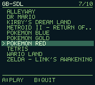
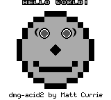
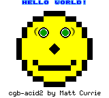

# Game Boy / Game Boy Color emulator (Rust)

A Game Boy (DMG) and Game Boy Color (CGB) emulator written in Rust, built as a learning project:
readable code, hardware behaviour explained in comments, and every claim backed by a test.
It plays Pokémon Red, Blue and Gold with battery saves and the real-time clock, runs on a
**Steam Deck** (gamepad and sound), and passes the standard community test ROMs it was built
against (Blargg, Mooneye, acid2). The exact scoreboard, including what still fails and why, is in
[docs/ACCURACY.md](docs/ACCURACY.md).

| Game list | dmg-acid2 | cgb-acid2 |
|---|---|---|
|  |  |  |

*The list uses made-up game names. The other two are our own output for Matt Currie's
[dmg-acid2](https://github.com/mattcurrie/dmg-acid2) and
[cgb-acid2](https://github.com/mattcurrie/cgb-acid2) test ROMs, which draw this face only when
the PPU is right. No commercial game is shown anywhere in this repository.*

## Features

- **CPU, timing**: the full SM83 instruction set, with the whole system advancing one M-cycle on
  every bus access (instruction timing is not a table, it falls out of the accesses).
- **Hardware**: timer and divider, OAM DMA, CGB VRAM DMA (general and HBlank), serial port,
  interrupts, double-speed mode, joypad.
- **Graphics**: DMG and CGB PPU (scanline renderer), with selectable DMG colour schemes.
- **Sound**: four channels, stereo mixing at the output device's rate (DMG sound model).
- **Cartridges**: ROM only, MBC1 (including multicarts), MBC3 with the real-time clock, MBC5;
  battery saves written atomically.
- **Save states**: nine slots per game, versioned and checksummed; a damaged or foreign state is
  refused without touching the running game.
- **Frontend (`gb-sdl`)**: a game list, gamepad and keyboard input with a config file, pause,
  reset, slow motion, screenshots, quick save and load.
- **Deterministic**: the same ROM and the same button presses always give the same pictures and
  audio, so a recorded playthrough replays identically (`gb-sdl --record`, `gb-cli --input`).
- **Safe by construction**: the core has no dependencies, no `unsafe`, no threads and no I/O.
  Corrupt ROMs, saves and state files return errors (see
  [crates/gb-core/tests/robustness.rs](crates/gb-core/tests/robustness.rs)).

Not supported, on purpose: link cable, netplay, rewind, fast-forward, shaders, a debugger GUI,
cartridge types beyond MBC1/3/5 (MBC2, MBC6, MBC7, HuC), and cycle-exact mid-scanline PPU effects.
See [docs/ACCURACY.md](docs/ACCURACY.md) for the details.

## Quick start

Requirements: Rust stable ([rustup](https://rustup.rs/)) and the SDL2 development files for the
desktop frontend (`sudo apt install libsdl2-dev` on Debian/Ubuntu). The core and the headless
runner need nothing else. On Windows, build and run inside WSL.

```sh
cargo build --release -p gb-sdl

# Put your own dumped ROMs (.gb / .gbc) in games/ next to the program, then:
mkdir -p games && cp ~/my-roms/*.gb* games/
cargo run --release -p gb-sdl -- .          # opens the game list for this folder

# Or play one game directly (its save goes beside the ROM):
cargo run --release -p gb-sdl -- path/to/game.gb
```

With no argument, `gb-sdl` lists the games under the `games/` folder of the folder the program
lives in. Saves, save states and screenshots go to `saves/` and `screenshots/` there, created only
when first needed. See [docs/STEAMDECK.md](docs/STEAMDECK.md) for running it on a Steam Deck, and
`scripts/package_deck.sh` to build a ready-to-copy package.

### Controls

| | Keyboard | Gamepad |
|---|---|---|
| D-pad, A, B, Start, Select | arrows, X, Z, Enter, Backspace or Right Shift | D-pad or left stick, A, B, Menu, View |
| Pause / reset | P / F10 | |
| Slow motion (hold) | S | |
| Quick save / quick load / next slot | F5 / F8 / F6 | |
| DMG colour scheme | F9 | |
| Screenshot | F12 | |
| Fullscreen | F11 | |
| Back to the game list / quit | Esc | hold Start+Select for 1.5 s |
| Mute a sound channel / volume | 1-4 / + - | |

Everything can be rebound in `config.ini`; the commented template is
[crates/gb-sdl/config.example.ini](crates/gb-sdl/config.example.ini).

## Build and test

```sh
cargo build --workspace
cargo fmt --all -- --check
cargo clippy --workspace --all-targets -- -D warnings
bash scripts/fetch_test_roms.sh        # pinned, checksum-verified test-ROM bundle into tests/roms/
bash scripts/fetch_doctor_logs.sh      # Gameboy Doctor reference traces
cargo test --workspace                 # ROM tests skip, with a message, if their ROM is absent
bash scripts/run_all_tests.sh          # same, and prints the scoreboard table
```

On Windows with Smart App Control, test executables may be blocked: run the tests in WSL.

### Headless runner

```sh
cargo run -p gb-cli -- run game.gb                           # print the header
cargo run -p gb-cli -- run game.gb --frames 600 --screenshot out.png
cargo run -p gb-cli -- run game.gb --frames 600 --compare expected.png
cargo run -p gb-cli -- run --help                            # serial output, traces, WAV, input scripts, ...
```

## Repository layout

| Path | What is in it |
|---|---|
| `crates/gb-core` | The emulator. Standard library only, no I/O. |
| `crates/gb-cli` | Headless runner for tests, traces and screenshots. |
| `crates/gb-sdl` | Desktop and Steam Deck frontend. |
| `docs/ARCHITECTURE.md` | How it fits together; how to add a mapper or a test suite. |
| `docs/ACCURACY.md` | Test scoreboard and what fails. |
| `docs/STEAMDECK.md` | Setting it up on a Steam Deck. |
| `docs/REFERENCES.md` | Hardware documentation and test-ROM sources. |
| `docs/phases/` | The step-by-step build plan this project followed. |
| `PROGRESS.md` | Running log: what was done, measured and decided. |
| `scripts/` | Test-ROM download, scoreboard, Steam Deck package. |

## Legal note

This repository contains **no commercial game ROMs and no BIOS**; the emulator starts in the
post-boot state directly. Place your own dumped ROMs in `games/` (or `roms/`), which are
git-ignored, and never commit or share them. Writing an emulator is legal; commercial ROMs are
copyrighted. Third-party test ROMs are downloaded by script and keep their own licences.

The code is MIT licensed (see [LICENSE](LICENSE)).
